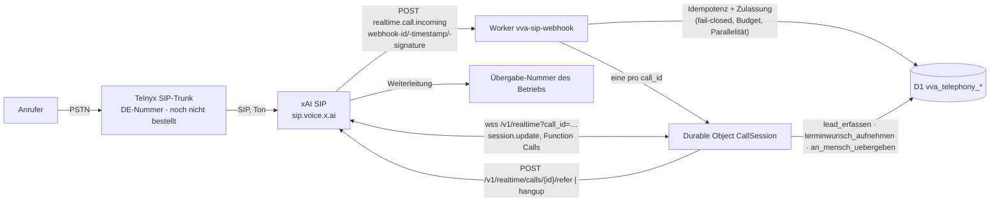

# Vertical Voice Agent – Telefonie-Architektur (nur VVA)

Stand: 30.10.2026 · Status: **implementiert, getestet, deployt (Test), nicht produktiv** · `TELEPHONY_ENABLED=false`

- **Ton** läuft nur Telnyx ↔ xAI. Der Worker sieht kein Audio und speichert keins.
- **Tool-Calls und Session-Events** kommen ausschließlich über die WebSocket-Verbindung der Durable Object, nicht per Webhook. Die Durable Object bleibt für die Gesprächsdauer verbunden (Alarm = Höchstdauer, Standard 10 min → `hangup`).
- **Mandant** wird aus der angerufenen Nummer (SIP `To`) im D1 bestimmt und für jedes Werkzeug aus dem Anruf-Datensatz geladen, nie aus Werkzeug-Argumenten.
- **Gesprächsinhalt** ändert keine Prompts, Werkzeuge oder Rechte (Konfiguration kommt nur aus D1).
- **Datenstandort:** xAI verarbeitet in den USA/weltweit; Auftragsverarbeitung über xAI-DPA (Standardvertragsklauseln). Keine EU-Hosting-Zusage. Laut xAI-DPA dürfen personenbezogene Daten nur über die ZDR-API (Zero Data Retention) verarbeitet werden → ZDR für das xAI-Team ist Pflicht vor dem Livegang.

## Dateien
| Pfad | Zweck |
|---|---|
| `workers/vva-sip-webhook/src/index.js` | Webhook, Signatur, Idempotenz, Durable Object, refer/hangup |
| `workers/vva-sip-webhook/src/core.js` | Validator, Zulassung, Session-Konfiguration, drei Werkzeuge, Protokoll, Aufbewahrung |
| `workers/vva-sip-webhook/migrations/` | D1-Schema + Seed (8 Vorlagen, Demo-Mandanten) |
| `workers/vva-sip-webhook/test/run.mjs` | 34 Tests (Miniflare, Telefonie aus / DRY_RUN) |

## Umgebungen
| | Test | Prod |
|---|---|---|
| Worker | `vva-sip-webhook-test` | `vva-sip-webhook-prod` (ohne Secrets, 503) |
| D1 | `vva_telephony_test` | `vva_telephony_prod` (nur Vorlagen) |
| Secrets | `XAI_API_KEY`, `XAI_WEBHOOK_SECRET` gesetzt (30.10.2026) | eigener Prod-Key, getrennt |
| Telefonie | aus | aus |

## Live-Smoke 30.10.2026 (ohne PSTN)
| Prüfung | Ergebnis |
|---|---|
| `/health` Test-Worker | secrets_configured=true, telephony_enabled=false |
| Signierter `realtime.call.incoming` | 200, `accepted:false`, `TELEPHONY_DISABLED` (kein Session-Beitritt) |
| Replay gleicher webhook-id | `duplicate` |
| Falsche Signatur | 401 |
| xAI-WebSocket ohne `call_id` mit unserer Session-Konfiguration | akzeptiert, keine Fehler |
| Werkzeuge | nur `terminwunsch_aufnehmen` aufgerufen (korrekte Felder), keine fremden Werkzeuge |
| Terminbestätigung | Modell: „…eine Bestätigung kann ich nicht geben. Wir melden uns zur Bestätigung.“ |
| `lead_erfassen` | im Smoke nicht aufgerufen – Modell fragte wiederholt nach der (optionalen) Adresse. Prompt nachschärfen. |

## Nachtest 30.10.2026 (Prompt nachgeschärft, Test-Worker neu deployt)
Adresse/Dringlichkeit bei `lead_erfassen` ausdrücklich optional (System-Prompt, Werkzeugbeschreibung, Feldbeschreibung). Live-Smoke 9/9: `lead_erfassen` aufgerufen mit Name, Rückrufnummer, Anliegen – ohne Adresse; `terminwunsch_aufnehmen` ohne feste Zusage („Wir melden uns zur Bestätigung.“). Telefonie weiterhin aus.

## Einsatzort (30.10.2026)
Kein globales Pflichtfeld. Nur Handwerk (Reparatur/Wartung/Notfall), Kfz (Panne vor Ort) und Hausverwaltung (Schaden) fragen einmal danach; bei Öffnungszeiten-Fragen nie. Live-Smoke 10/10.

## Go-live-Reihenfolge
1. Telnyx DE-Nummer → 2. xAI DPA + ZDR (erst Test-Team, Smoke, dann Prod) → 3. Prod-Secrets + erster Mandant → 4. Testanrufe → 5. Stripe-Name. Details: `GO_LIVE.md`.
